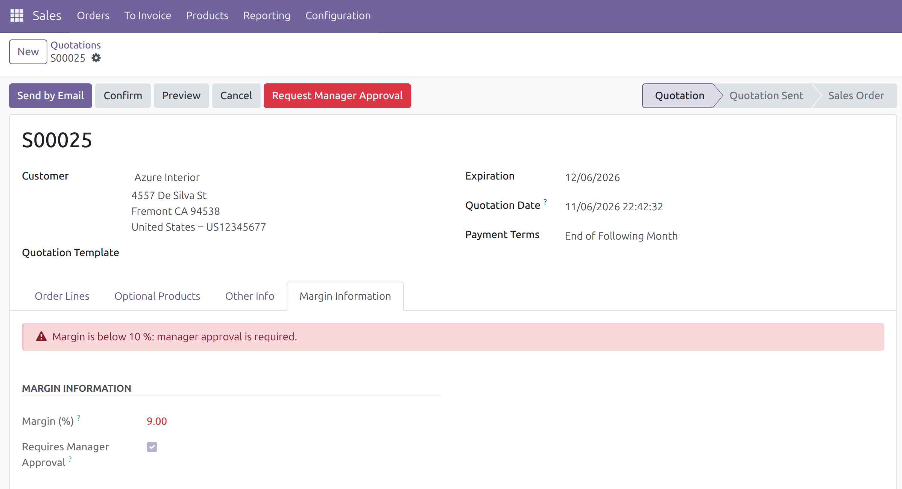
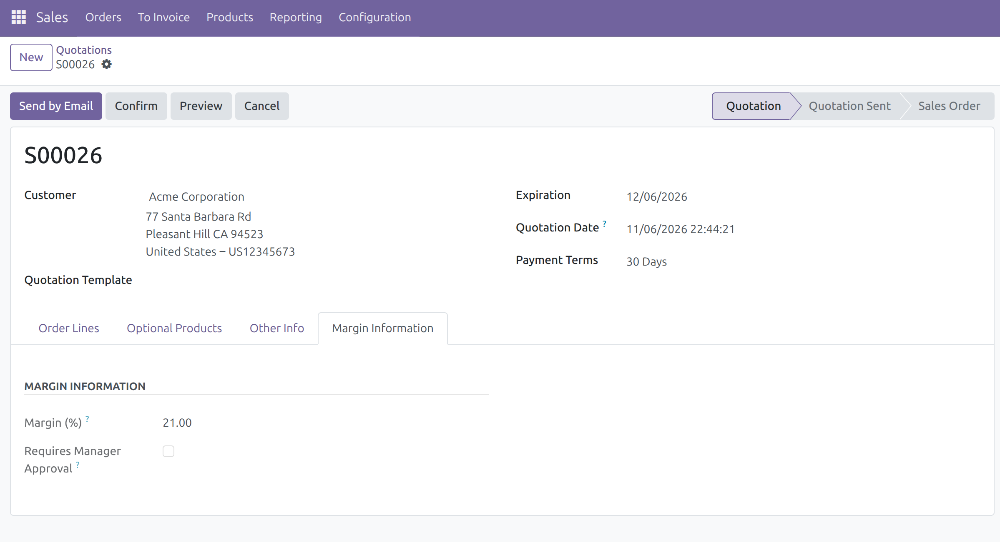
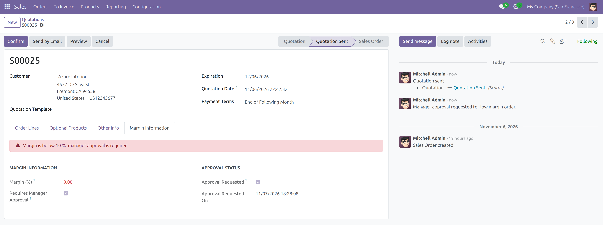
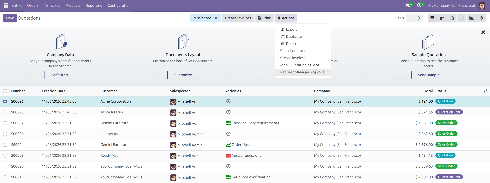
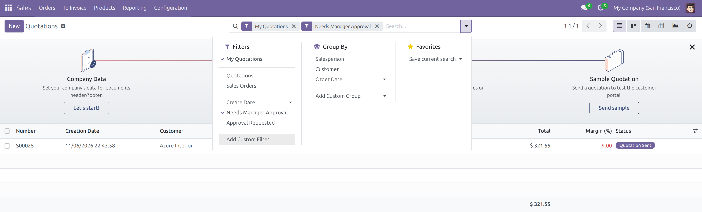
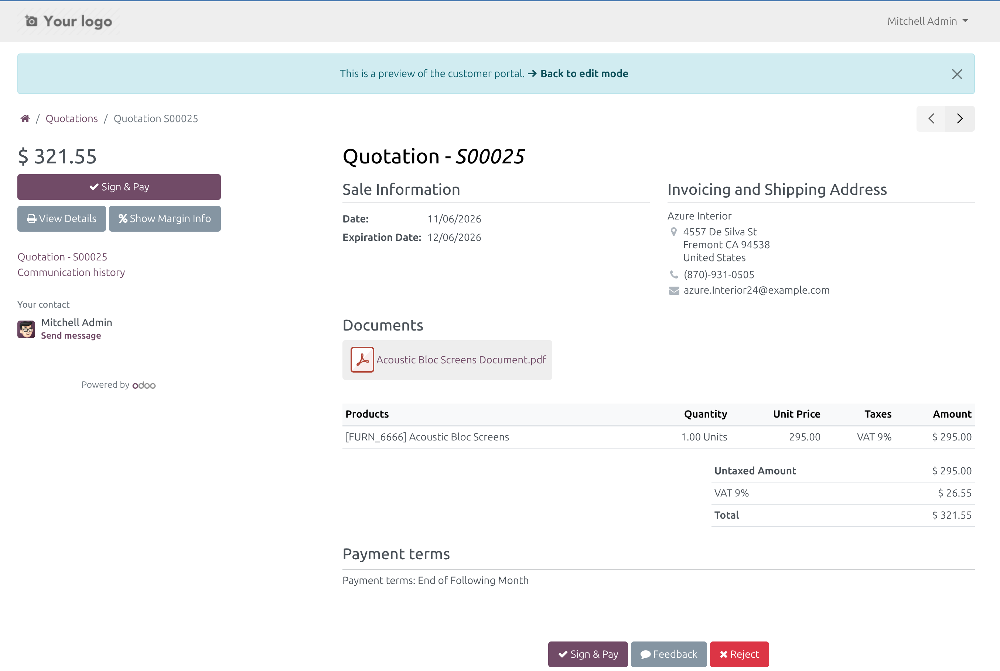
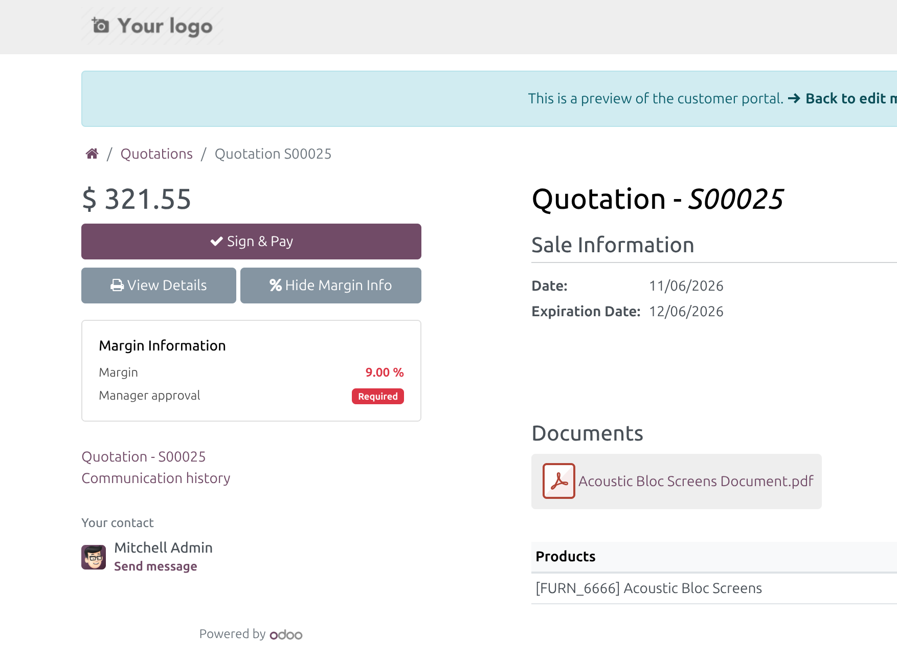
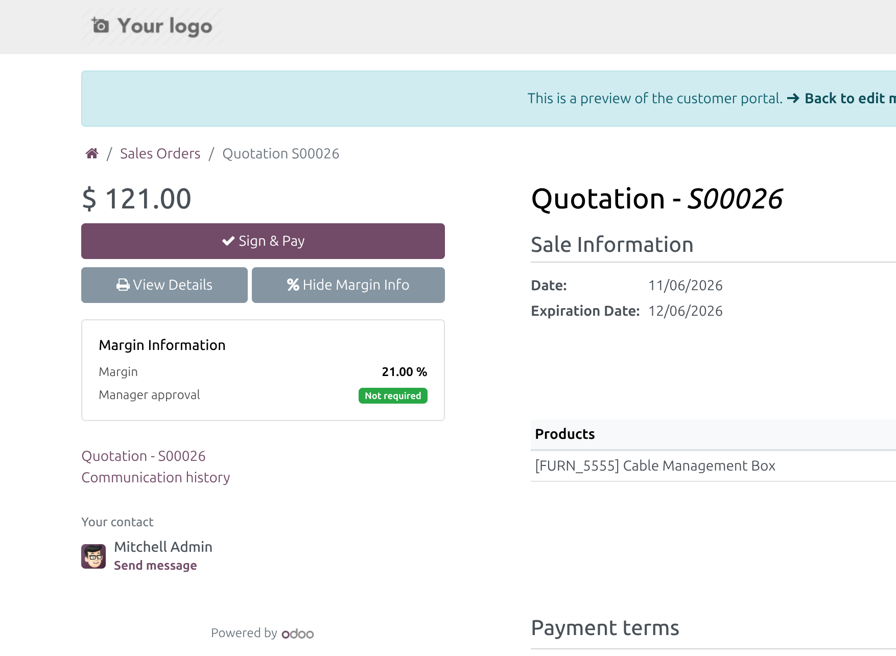
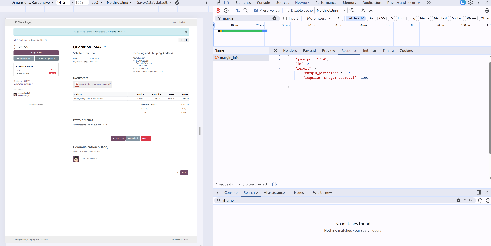
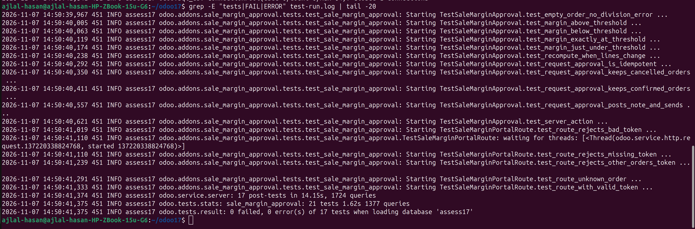

# Odoo 17 Technical Assessment – Ajlal Hasan

This repository holds my solution for Part 1 and Part 2 of the assessment: one Odoo 17 module, `sale_margin_approval`, plus screenshots of it running. Part 3 (the two customer cases) is in the PDF I sent with my email.

- **Demo video (3 min):** [Google Drive](https://drive.google.com/drive/folders/1IEva81hJ5N9d-x2QNrLQjNIP6WbZiXy2)
- **Tested on:** Odoo 17.0 Community, fresh database. Installs without errors, all 17 automated tests pass.

## What's here

```
sale_margin_approval/   the module (Part 1 backend + Part 2 portal + tests)
screenshots/            10 screenshots of the module in Odoo 17
```

To try it, copy `sale_margin_approval` into your addons path and install **Sale Margin Approval** from Apps. It only depends on `sale`. To run the tests:

```bash
odoo-bin -d <db> -u sale_margin_approval --test-enable --test-tags /sale_margin_approval --stop-after-init
```

## Part 1 – Backend

| Low margin (9 % VAT) | Normal margin (21 % VAT) |
| --- | --- |
|  |  |
| **After "Request Manager Approval"** | **Server action in the Actions menu** |
|  |  |



## Part 2 – Portal

| Button next to the document button | Panel, approval required |
| --- | --- |
|  |  |
| **Panel, approval not required** | **JSON route in DevTools** |
|  |  |

## Tests



## Choices worth knowing about

1. **Odoo 17 removed `attrs` and `ajax.jsonRpc`.** I used what replaced them: `invisible` / `decoration-danger` in the view, and `jsonrpc` from `@web/core/network/rpc_service` inside a normal `publicWidget`.
2. **Exactly 10 % does not need approval.** The raw division isn't exact: €99.90 with 10 % tax (€9.99) gives `9.999999999999993`. The field already rounds to 2 decimals, and I compare with `float_compare` on the same precision so the rule doesn't depend on that rounding. A test uses that exact amount.
3. **Only draft quotations move to "sent".** A confirmed or cancelled order is never pushed back.
4. **The button works once.** A second click posts nothing, and the Actions-menu version skips normal-margin orders. Duplicating the quotation resets it.
5. **The portal route checks access** the same way the portal page does (record rules or a valid access token) and returns `{"error": "not_found"}` otherwise.
6. **The formula in the brief gives the tax rate, not a margin.** With Dutch VAT at 21 % and 9 %, every 9 % order would always need approval. I built it as specified; for production I'd use `margin_percent * 100` from Odoo's `sale_margin` module (it's stored as a fraction).

More detail on the design is in [`sale_margin_approval/README.md`](sale_margin_approval/README.md).
